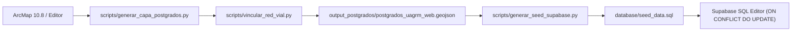

# FASE 1: CAPA DE BASE DE DATOS ESPACIAL (SUPABASE / POSTGIS)
## Proyecto WebGIS INF442-SA: Escuelas y Unidades de Postgrado UAGRM 2026

Este módulo implementa la capa persistente de base de datos geográfica en **Supabase (PostgreSQL 15+ con extensión PostGIS)** a partir de las geometrías y atributos validados cartográficamente en **ArcGIS Desktop / ArcMap 10.8**.

---

## 1. Estructura de Archivos

```
proyecto postgrados sig/
├── database/
│   ├── schema.sql              # DDL: Extensión PostGIS, tablas, índices GiST/B-Tree y RLS
│   ├── seed_data.sql           # DML: Inserción idempotente (19 postgrados + 12 servicios de apoyo)
│   ├── verify_postgis.sql      # Consultas SQL de prueba, conteo, GeoJSON y ST_DWithin
│   └── README_SUPABASE.md      # Este manual de despliegue y sincronización
├── output_postgrados/
│   └── postgrados_uagrm_web.geojson # GeoJSON validado desde ArcMap 10.8 (Fuente de datos)
└── scripts/
    └── generar_seed_supabase.py # Script generador reproducible (Python 2.7 y 3.x)
```

---

## 2. Instrucciones de Despliegue en Supabase

### Paso 1: Crear el Esquema y Tablas (`database/schema.sql`)
1. Ingresá a tu proyecto en el panel de **Supabase** ([supabase.com](https://supabase.com)).
2. En la barra lateral izquierda, abrí el **SQL Editor** (`New query`).
3. Copiá y pegá el contenido completo de [`database/schema.sql`](file:///c:/Users/Ale/Documents/sig/proyecto_postgrados_sig/database/schema.sql).
4. Presioná **Run**.
   - Habilita `CREATE EXTENSION IF NOT EXISTS postgis;`.
   - Crea la tabla `public.postgrados_uagrm` con 24 atributos alfanuméricos y 3 columnas geométricas (`geom`, `geom_acceso`, `geom_poly`).
   - Crea la tabla `public.servicios_apoyo` (Requisito #22: extintores, centros médicos, accesos, puntos de encuentro).
   - Crea los índices espaciales `GiST` y de filtrado `B-Tree`.
   - Activa `Row Level Security (RLS)` permitiendo lectura pública (`SELECT`) para clientes anónimos/autenticados y protegiendo la escritura.

### Paso 2: Cargar los Datos Iniciales (`database/seed_data.sql`)
1. En el **SQL Editor** de Supabase, abrí una nueva pestaña (`New query`).
2. Copiá y pegá el contenido de [`database/seed_data.sql`](file:///c:/Users/Ale/Documents/sig/proyecto_postgrados_sig/database/seed_data.sql).
3. Presioná **Run**.
   - Inserta de forma **idempotente** (`ON CONFLICT (id_postg) DO UPDATE SET ...`) las **19 Unidades de Postgrado**.
   - Inserta de forma **idempotente** (`ON CONFLICT (id_serv) DO UPDATE SET ...`) los **12 Servicios de Apoyo** referenciales.
   - Las geometrías se construyen mediante `ST_SetSRID(ST_MakePoint(lon, lat), 4326)`.

### Paso 3: Ejecutar Verificación Espacial (`database/verify_postgis.sql`)
1. En el **SQL Editor**, copiá y ejecutá [`database/verify_postgis.sql`](file:///c:/Users/Ale/Documents/sig/proyecto_postgrados_sig/database/verify_postgis.sql).
2. Verificá los 4 resultados:
   - **Prueba 1:** Versión de PostGIS activa (soporte GEOS, PROJ, GDAL).
   - **Prueba 2:** Conteo de 19 postgrados y 12 servicios de apoyo, con tildes y eñes íntegras (`Dirección`, `Auditoría`, `Hábitat`, `Diseño`, `Politécnica`).
   - **Prueba 3:** Extracción GeoJSON nativa para `UAGRM-PG-FICCT` (`ST_AsGeoJSON`).
   - **Prueba 4:** Consulta de proximidad con `ST_DWithin` a un radio de 600 metros de la FICCT (`PG-16`), listando extintores, centros médicos y accesos ordenados por metros (`ST_Distance`).

---

## 3. Flujo de Sincronización Continua ArcMap 10.8 -> Supabase

Cada vez que se modifiquen coordenadas, atributos o la red vial en **ArcMap 10.8**:



### Comando para Regenerar el Seed SQL:
El script generador está escrito utilizando **únicamente la librería estándar de Python**, por lo que es compatible con cualquier entorno:

```bash
# Con Python 3:
python scripts/generar_seed_supabase.py

# O con el entorno Python 2.7 de ArcGIS 10.8:
C:\Python27\ArcGIS10.8\python.exe scripts/generar_seed_supabase.py
```

Al ejecutarse:
- Lee dinámicamente `output_postgrados/postgrados_uagrm_web.geojson`.
- Escapa comillas simples y formatea números.
- Sobrescribe `database/seed_data.sql` en codificación **UTF-8 pura**.
- Al correr nuevamente en Supabase, la cláusula `ON CONFLICT DO UPDATE` actualiza los registros sin duplicar datos ni requerir `DROP TABLE`.

---

## 4. Estructura de Tablas y Seguridad

### Tabla `public.postgrados_uagrm`
| Campo | Tipo SQL | Descripción |
|---|---|---|
| `id_postg` | `VARCHAR(10) PRIMARY KEY` | Código único (`PG-00` a `PG-18`). |
| `cod_fac` | `VARCHAR(12)` | Sigla oficial facultativa (`FICCT`, `DGP`, etc.). |
| `nom_unidad` | `VARCHAR(120)` | Nombre completo de la Unidad de Postgrado. |
| `nom_facult` | `VARCHAR(120)` | Facultad a la que pertenece. |
| `tipo_ent` | `VARCHAR(25)` | `Rectorado_DGP`, `Unidad_Facultativa`, `Sede_Provincial`. |
| `ambito` | `VARCHAR(15)` | `Urbano` o `Provincial`. |
| `municipio` | `VARCHAR(40)` | Municipio de radicatoria. |
| `campus` | `VARCHAR(40)` | Predio o campus (`Ciudad Universitaria`, `Campus Universitario`, etc.). |
| `modulo_pab` | `VARCHAR(50)` | Pabellón o módulo físico. |
| `direccion` | `VARCHAR(150)` | Dirección vial oficial. |
| `lat_wgs84`, `lon_wgs84` | `DOUBLE PRECISION` | Coordenadas geográficas WGS 84. |
| `lat_ruta`, `lon_ruta` | `DOUBLE PRECISION` | Coordenadas del nodo de acceso a la vía. |
| `dist_via_m` | `NUMERIC(8,2)` | Distancia ortogonal al eje vial en metros. |
| `telefono`, `correo`, `horario` | `VARCHAR` | Datos de contacto y atención al público. |
| `estado_geo` | `VARCHAR(20)` | `Verificado` o `Revisar_Campo`. |
| `cod_qr` | `VARCHAR(30) UNIQUE` | Código para consulta móvil/QR (`UAGRM-PG-...`). |
| `area_m2` | `NUMERIC(10,2)` | Área de la huella en m² (calculada en ArcMap). |
| `programas` | `TEXT` | Oferta de postgrado (Doctorados, Maestrías, Diplomados). |
| `sitio_web`, `url_foto` | `VARCHAR(150)` | Enlace web y ruta del recurso fotográfico. |
| `geom` | `geometry(Point, 4326)` | Ubicación principal del edificio. |
| `geom_acceso` | `geometry(Point, 4326)` | Nodo de acceso vial navegable. |
| `geom_poly` | `geometry(Polygon, 4326)` | Huella poligonal digitalizada. |
| `updated_at` | `TIMESTAMPTZ` | Marca de tiempo de última actualización. |

### Tabla `public.servicios_apoyo`
| Campo | Tipo SQL | Descripción |
|---|---|---|
| `id_serv` | `VARCHAR(15) PRIMARY KEY` | Código único (`SERV-01` a `SERV-12`). |
| `nombre` | `VARCHAR(120)` | Denominación del servicio. |
| `tipo` | `VARCHAR(30)` | `Centro_Medico`, `Extintor`, `Acceso_Campus`, `Punto_Encuentro`. |
| `campus` | `VARCHAR(60)` | Campus de ubicación. |
| `referencia` | `VARCHAR(150)` | Descripción de ubicación física. |
| `horario` | `VARCHAR(60)` | Turno o disponibilidad. |
| `es_referencial` | `BOOLEAN` | `TRUE` para capas base editables. |
| `geom` | `geometry(Point, 4326)` | Posición geográfica puntual. |
| `updated_at` | `TIMESTAMPTZ` | Timestamp de auditoría. |

### Políticas de Seguridad (RLS)
- Ambas tablas tienen activado **Row Level Security (RLS)**.
- Solo se autoriza `SELECT` a roles `anon` y `authenticated`.
- Cualquier modificación (`INSERT`, `UPDATE`, `DELETE`) requiere conexión autenticada de servicio (`postgres` / `service_role`), como la utilizada por el backend en **FastAPI**.
